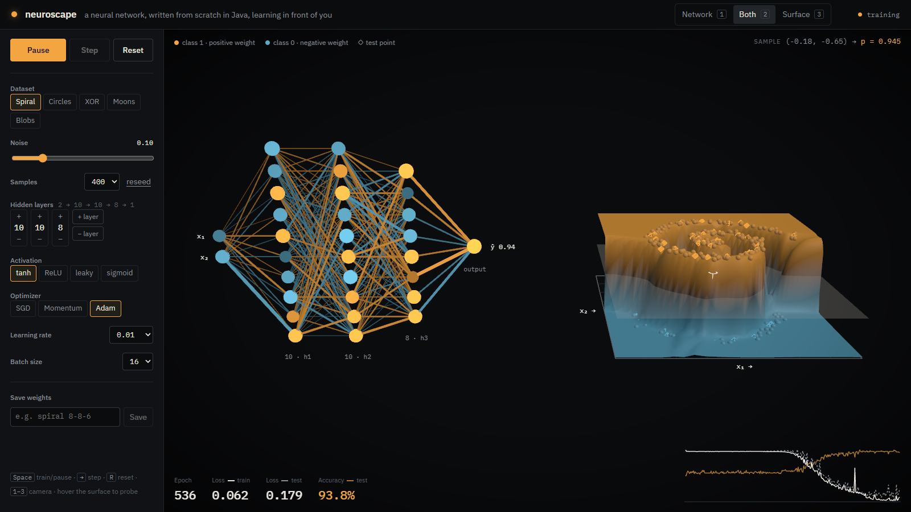
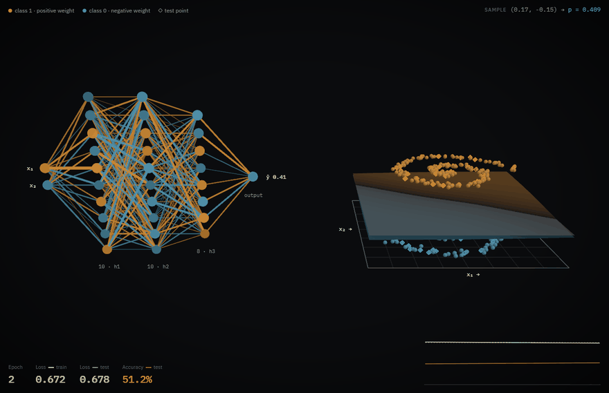
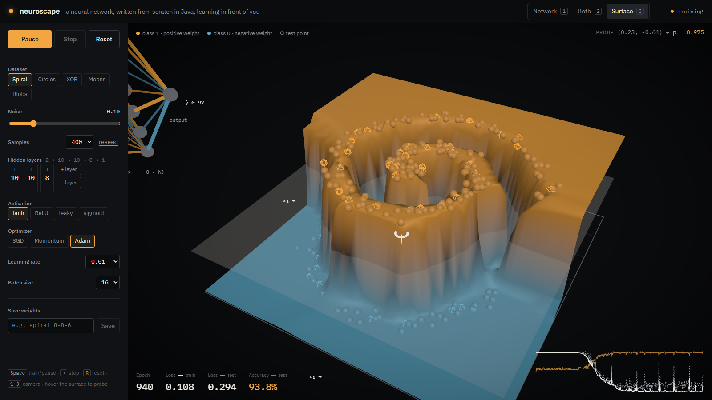
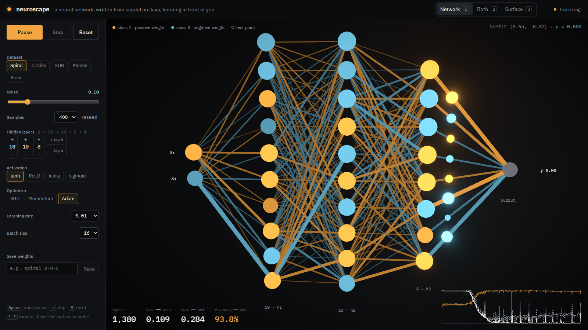
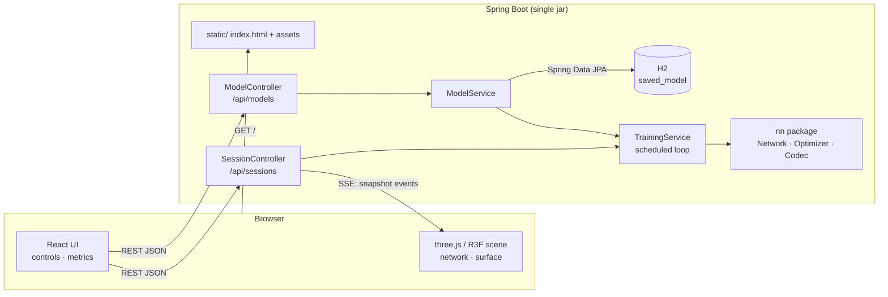

# neuroscape

**Watch a neural network learn, in 3D.** A multilayer perceptron written from scratch in plain Java
(no ML libraries) trains live inside a Spring Boot server. Every few milliseconds the server streams its
weights, metrics and decision surface to a React + three.js frontend over Server-Sent Events.

[](https://github.com/Ericson3100/neuroscape/actions/workflows/ci.yml)




<details>
<summary>Animated: a 2-10-10-8-1 network learning the spiral (GIF, 2.4 MB)</summary>



</details>

## What you are looking at

| | |
|---|---|
| **Left: the network** | Neurons are spheres, one column per layer. Every connection is a cylinder whose **thickness is the weight's magnitude** and whose **colour is its sign** (amber positive, steel negative). Pulses travel layer by layer carrying `w · a` for the sample under your cursor, and neurons light up with their activation when the wave arrives. |
| **Right: the decision surface** | The model's output `p(class 1 \| x₁, x₂)` evaluated on a 48 × 48 grid, drawn as a height field that morphs as the network trains. Training points sit at height 0 or 1 by label, so the surface *rises to meet them* as the model fits. The translucent plane at `p = 0.5` cuts the surface exactly along the decision boundary. Octahedra are held-out test points. |
| **Bottom: metrics** | Train loss (solid), test loss (dashed) and test accuracy (amber) per epoch. Leave a big network training on a noisy spiral and you can watch it start to overfit. |




## Features

- **From-scratch neural network** in Java: dense layers, tanh / ReLU / leaky ReLU / sigmoid, sigmoid +
  binary cross-entropy output, mini-batch back-propagation, **SGD, momentum and Adam**. Verified by a
  numerical **gradient check**.
- **Five toy datasets**: spiral, circles, XOR, two moons, Gaussian blobs, with adjustable noise and
  an 80/20 train/test split. Everything is seeded and reproducible.
- **Live training over SSE**: a scheduled loop trains all running sessions and pushes snapshots to every
  subscriber; play / pause / single-step / reset from the UI or the REST API.
- **3D rendering** with `@react-three/fiber`: instanced meshes for edges, neurons and pulses, a
  vertex-coloured height field, bloom, and smooth camera moves between *Network*, *Both* and *Surface*
  shots (`1` `2` `3`).
- **Probe any point**: hover the surface to run that input through the network and watch it propagate.
- **Save and load models**: weights are persisted in H2 via Spring Data JPA. Load one into a new session to
  keep training, or call `predict` on it directly.
- **Accessible motion**: `prefers-reduced-motion` turns off camera tweens, morphing and pulses. Every
  control works from the keyboard.

## Architecture

One Maven project, one jar, one port. The frontend is built by `frontend-maven-plugin` during
`mvn package` and bundled into Spring's static resources; a resource resolver falls back to
`index.html` for client-side routes.



```
src/main/java/dev/ericson/neuroscape
├── nn/         Network, Activation, Optimizer (SGD | Momentum | Adam), Gradients, NetworkCodec
├── data/       DatasetType, DatasetGenerator, Dataset, Sample
├── training/   TrainingService (scheduler + SSE fan-out), TrainingSession, snapshots
├── model/      SavedModel (JPA entity), SavedModelRepository, ModelService
├── api/        REST controllers, record DTOs with jakarta.validation, RFC 9457 error handler
└── config/     @ConfigurationProperties, SPA fallback
frontend/src
├── scene/      Scene, NetworkGraph, DecisionSurface, CameraRig
├── hooks/      useTrainingSession (session lifecycle + EventSource), useSavedModels
└── components/ control rail, metrics strip, loss chart
```

## How the math works

For one sample, layer `l` computes

```
z⁽ˡ⁾ = W⁽ˡ⁾ a⁽ˡ⁻¹⁾ + b⁽ˡ⁾        a⁽ˡ⁾ = f(z⁽ˡ⁾)        a⁽⁰⁾ = x
```

with `f` the chosen hidden activation and a sigmoid `σ` on the single output unit. The loss is binary
cross-entropy `L = −[y log p + (1 − y) log(1 − p)]`. Sigmoid and BCE cancel neatly, so the error at the
output is simply

```
δ⁽ᴸ⁾ = p − y
```

Back-propagation walks backwards, accumulating gradients and pushing the error through the transposed
weights:

```
∂L/∂W⁽ˡ⁾ = δ⁽ˡ⁾ a⁽ˡ⁻¹⁾ᵀ      ∂L/∂b⁽ˡ⁾ = δ⁽ˡ⁾      δ⁽ˡ⁻¹⁾ = (W⁽ˡ⁾ᵀ δ⁽ˡ⁾) ⊙ f′(z⁽ˡ⁻¹⁾)
```

Gradients are averaged over a shuffled mini-batch and handed to the optimizer, which updates the
parameter arrays in place:

| Optimizer | Update |
|---|---|
| SGD | `θ ← θ − η g` |
| Momentum | `v ← μ v − η g`, `θ ← θ + v` (μ = 0.9) |
| Adam | `m ← β₁m + (1−β₁)g`, `v ← β₂v + (1−β₂)g²`, `m̂ = m/(1−β₁ᵗ)`, `v̂ = v/(1−β₂ᵗ)`, `θ ← θ − η m̂/(√v̂ + ε)` |

Weights use He initialisation for ReLU-family activations and Xavier/Glorot otherwise.
`NetworkTest.backpropMatchesNumericalGradient` checks every analytic derivative against the central
difference `(L(θ+h) − L(θ−h)) / 2h`. The worst relative error must stay below `1e-6`.

## API

All errors are returned as `application/problem+json` ([RFC 9457](https://www.rfc-editor.org/rfc/rfc9457)); validation errors include a field → message map.

| Method | Path | Description |
|---|---|---|
| `POST` | `/api/sessions` | Create a session from a config (dataset, samples, noise, hiddenLayers, activation, optimizer, learningRate, batchSize, seed?). Returns dataset, history and the first snapshot. |
| `GET` | `/api/sessions/{id}` | Full session state |
| `DELETE` | `/api/sessions/{id}` | Discard a session |
| `GET` | `/api/sessions/{id}/stream` | `text/event-stream` of `snapshot` events (metrics, weights, prediction grid) |
| `POST` | `/api/sessions/{id}/play` · `/pause` · `/reset` | Control the training loop |
| `POST` | `/api/sessions/{id}/step?epochs=1` | Train N epochs synchronously (1–1000) |
| `POST` | `/api/sessions/{id}/predict` | `{x, y}` → probability, label and every layer's activations |
| `GET` | `/api/models` | List saved models |
| `POST` | `/api/models` | `{sessionId, name}`: persist the session's current weights |
| `GET` · `DELETE` | `/api/models/{id}` | Inspect / delete a saved model |
| `POST` | `/api/models/{id}/load` | Start a new session from saved weights (keeps the epoch count) |
| `POST` | `/api/models/{id}/predict` | Predict with a saved model |
| `GET` | `/actuator/health` | Health check |

```bash
curl -s -X POST localhost:8080/api/sessions -H 'Content-Type: application/json' -d '{
  "dataset":"SPIRAL","samples":400,"noise":0.1,"hiddenLayers":[10,10,8],
  "activation":"TANH","optimizer":"ADAM","learningRate":0.01,"batchSize":16,"seed":7}'
```

## Running it

Requirements: **JDK 21+**. Node is downloaded by the build; you don't need it installed.

```bash
./mvnw verify                        # builds the frontend, compiles, runs all tests
java -jar target/neuroscape-*.jar    # http://localhost:8080
```

Saved models go to an H2 file database in `./data` (override with `NEUROSCAPE_DATA_DIR`). Other
settings live under `neuroscape.*` in `application.yml`: grid resolution, tick rate, epochs per tick,
session limits.

**Docker**

```bash
docker build -t neuroscape .
docker run -p 8080:8080 -v neuroscape-data:/data neuroscape
```

**Frontend development** with hot reload (Vite proxies `/api` to `:8080`):

```bash
java -jar target/neuroscape-*.jar     # or ./mvnw spring-boot:run
cd frontend && npm install && npm run dev   # http://localhost:5173
```

For a backend-only build, skip the frontend with `-Dskip.installnodenpm -Dskip.npm`.

## Tests

`./mvnw verify` runs:

- **`NetworkTest`**: gradient check for tanh, sigmoid and leaky ReLU; every optimizer reduces loss; a
  2-8-8-1 net learns XOR (≥ 95 % test accuracy); codec round-trip; numerical stability.
- **`DatasetGeneratorTest`**: split sizes, class balance, bounds, determinism for every dataset.
- **`TrainingServiceTest`**: scheduler only trains running sessions, deterministic reset, bounded
  history, session limit and idle eviction (with an injectable `Clock`).
- **`SessionControllerTest`** (`@WebMvcTest`): status codes, `Location` header, bean-validation field
  errors, unknown enum values, method-parameter validation, 404 problem details.
- **`NeuroscapeApplicationTests`** (`@SpringBootTest`): train → save → list → predict → load → delete
  against H2, SSE handshake, actuator health, SPA fallback.

## Tech stack

**Backend:** Java 21, Spring Boot 4.1 (Web MVC, Data JPA, Validation, Actuator), H2, JUnit 5, AssertJ,
MockMvc · **Frontend:** React 19, TypeScript, Vite, three.js, @react-three/fiber, @react-three/drei,
@react-three/postprocessing, IBM Plex Sans/Mono · **Build/ops:** Maven Wrapper, frontend-maven-plugin,
multi-stage Dockerfile, GitHub Actions.

## Known limitations

- Sessions live in memory on one server instance; scaling out would need sticky sessions or a shared
  store. Idle sessions are evicted after 30 minutes.
- The network is a binary classifier on 2D inputs only. That restriction is what makes the whole
  decision surface drawable.
- Arithmetic is plain `double[]` loops, which is plenty for toy networks but makes no attempt at SIMD or GPU.

## License

[MIT](LICENSE) © Ericson López
